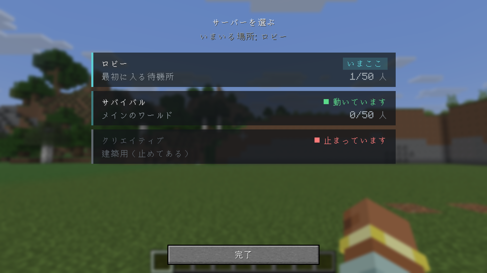
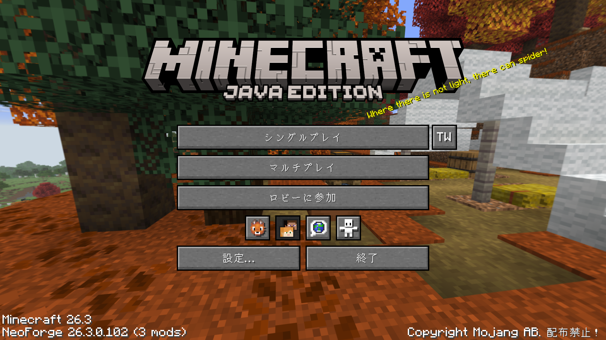
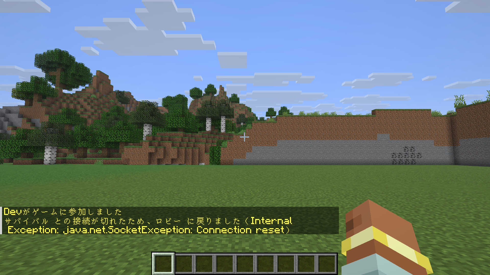

# mc-server-link

別々に建てた Minecraft サーバー同士をつないで、**行き来できるようにする** NeoForge 26.3 の Mod です。プロキシ（Velocity など）は使わず、vanilla の transfer（別のサーバーへ移す仕組み）で移動します。

- 対象: Minecraft 26.3 / NeoForge 26.3.0.102 以降（Minecraft 26.2 で使う場合は [v1.0.0](https://github.com/htani0817/mc-server-link/releases/tag/v1.0.0) を使ってください）
- 入れる場所: **つなぐ全部のサーバーと、各プレイヤーのクライアントの両方**
- Mod を入れていないクライアントもサーバーに入れます（一覧の画面と、落ちたときのつなぎ直しが無いだけです）
- Mod を入れたクライアントは、この Mod の無いサーバーにも入れます



## できること

| 場面 | 何が起きるか |
| --- | --- |
| タイトル画面で「ロビーに参加」 | `client.json` のロビーへつなぎます（Realms のボタンを置き換えます） |
| `/server` | Mod ありのクライアントはサーバーの一覧の画面、Mod なしならチャットに押せる一覧を出します |
| `/server <id>`・一覧の画面で選ぶ | 行き先が動いているかをその場で確かめてから移ります。止まっていれば「止まっているため移動できません」と出します |
| `/lobby` | ロビーへ移ります |
| 行き先が落ちた（クラッシュ・回線断・強制終了） | クライアントがロビーへつなぎ直し、着いたらチャットに理由を出します |
| ロビーにもつながらなかった | 2 つの理由を並べた切断の画面を出します（つなぎ直しは 1 回だけです） |
| ロビー以外のサーバーを `/stop` | 止める前に、入っている人をロビーへ送ります |
| ロビー以外へ直接入ってきた | 「最初は ロビー から入ってください」と出してロビーへ送ります（OP は送りません） |

| タイトル画面 | 落ちたあとロビーに戻ったとき |
| --- | --- |
|  |  |

## 導入

1. [Releases](https://github.com/htani0817/mc-server-link/releases) から `mc-server-link-<版>+mc26.3-neoforge.jar` をダウンロードします
2. つなぐ全部のサーバーの `mods/` に置いて、一度起動します。`config/mc_server_link/servers.json` に例が書き出されます（**例のままでは動きません**。直すまで移動を止めています）
3. `servers.json` を直します。**全部のサーバーに同じ一覧**を置き、`thisServer` だけをサーバーごとに変えます
4. 全部のサーバーの `server.properties` を `accepts-transfers=true` にします（ロビーも含めます）
5. サーバーを再起動するか、`/serverlink reload` を実行します
6. 各プレイヤーのクライアントの `mods/` にも jar を置きます

サーバーとクライアントは、同じ版にそろえてください。

### サーバーの設定（servers.json）

```json
{
  "thisServer": "survival",
  "lobby": "lobby",
  "servers": [
    { "id": "lobby", "name": "ロビー", "description": "最初に入る待機所", "address": "play.example.com:25565" },
    { "id": "survival", "name": "サバイバル", "description": "メインのワールド", "address": "play.example.com:25566", "statusAddress": "10.0.0.12:25566" }
  ],
  "statusIntervalSeconds": 10,
  "pingTimeoutMillis": 2000,
  "sendToLobbyOnStop": true,
  "sendDirectJoinsToLobby": true,
  "directJoinOpsBypass": true,
  "moveCooldownSeconds": 3
}
```

| 項目 | 意味 |
| --- | --- |
| `thisServer` | このサーバーの id |
| `lobby` | ロビーの id |
| `servers[].id` | コマンドで使う名前（英小文字・数字・`_`・`-`） |
| `servers[].name` / `description` | 画面に出す名前と説明。並び順が画面の並び順です |
| `servers[].address` | **プレイヤーがつなぐ**アドレス。transfer で送る先です |
| `servers[].statusAddress` | 動いているかを**サーバーから**確かめるアドレス。空なら `address` を使います。サーバー同士が内向きのアドレスでしか届かないとき（NAT の内側から自分の外向きのアドレスに届かないなど）に書きます |
| `statusIntervalSeconds` | ほかのサーバーを確かめる間隔（秒） |
| `pingTimeoutMillis` | 確かめるときの待ち時間（ミリ秒） |
| `sendToLobbyOnStop` | `/stop` のときロビーへ送る |
| `sendDirectJoinsToLobby` / `directJoinOpsBypass` | 直接入ってきた人をロビーへ送る / OP は送らない |
| `moveCooldownSeconds` | 1 人が続けて移動を頼めない間（秒） |

### クライアントの設定（client.json）

`config/mc_server_link/client.json` は初回起動で書き出されます。Mod パックで配るときは `lobbyAddress` を入れておいてください。

| 項目 | 既定 | 意味 |
| --- | --- | --- |
| `lobbyAddress` | 空 | 最初につなぐロビー。空ならタイトル画面のボタンを出しません |
| `lobbyName` | ロビー | ボタンに出す名前 |
| `titleButton` | true | Realms のボタンを「ロビーに参加」に置き換える |
| `autoConnect` | false | 起動したらそのままロビーへつなぐ |
| `failover` | true | 落ちたらロビーへつなぎ直す |
| `useServerLobby` | true | サーバーが教えるロビーのアドレスを使う（false なら常に `lobbyAddress`） |

### データパックのゲートからつなぐ

コマンドは関数の中からプレイヤーとして実行しても動きます。ゲートやボタンの関数で `server survival` を実行すると、そのサーバーへ移ります。引数なしの `server` は一覧の画面を開きます。

## コマンド

| コマンド | 誰が | 内容 |
| --- | --- | --- |
| `/server` | 全員 | 一覧（画面かチャット） |
| `/server <id>` | 全員 | そのサーバーへ移る |
| `/lobby` | 全員 | ロビーへ移る |
| `/serverlink status` | OP | 各サーバーのアドレス・状態・応答時間・版 |
| `/serverlink send <プレイヤー> <id>` | OP | プレイヤーを移す（待ち時間を見ない） |
| `/serverlink reload` | OP | `servers.json` を読み直す |

## 知っておいてほしいこと

- **持ち物・経験値はサーバーごとに別です**。そろえたいときは [mc-player-sync](https://github.com/htani0817/mc-player-sync) などを全部のサーバーに入れてください
- 「直接入ってきた人をロビーへ送る」は**防犯ではありません**。改造したクライアントなら直接入れます。入れたくない人は、各サーバーのホワイトリストで止めてください
- クライアントは、**サーバーが教えたロビー**へつなぎ直します（`useServerLobby`）。知らないサーバーにも入る人は、`useServerLobby=false` にすると `client.json` のロビーにしか戻りません
- サーバーごとに Mod の組み合わせが違うときは、クライアントが全部のサーバーに合う Mod を持っている必要があります
- サーバーが落ちずに**応答だけ止まった**（固まった）ときは、クライアントが切断に気づくまで 30 秒ほどかかります（vanilla の時間切れ）
- Youer（Bukkit 互換のサーバー）では、Mod のコマンドも Bukkit の権限 `minecraft.command.<名前>` で調べられます。この Mod は起動時に `minecraft.command.server` と `minecraft.command.lobby` を「既定で許可」として登録するので、OP でないプレイヤーも使えます。LuckPerms などで明示的に禁止すれば、そちらが優先されます

## ビルド

```bash
./gradlew test       # 単体テスト
./gradlew build      # Windows は gradlew.bat build。できた jar は dist/ にコピーされます
```

- ビルド出力は `~/.gradle/project-builds/mc-server-link/` に置きます（場所を変えるときは `-PmcBuildRoot=<パス>`）
- 開発用の起動:

  ```bash
  ./gradlew runServer                                   # offline モードにしてから使う
  ./gradlew runClient -PslJoin=127.0.0.1:25565 -PslUser=Dev
  ```

  `-PslJoin` を付けると、起動したらそのままそのサーバーに入ります（`localhost` は IPv6 になって入れないことがあるので、`127.0.0.1` を使ってください）

## ライセンス

[MIT](LICENSE)
